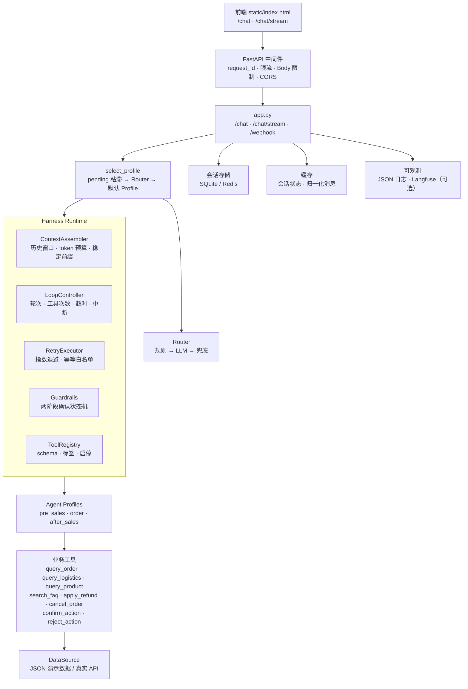

# 基于自研 Harness 的电商多 Agent 智能客服系统

> 本项目基于开源单 Agent 电商客服底座，重构了 Agent Harness 运行时，引入多 Agent 路由、Redis 会话与缓存、写操作两阶段确认、全链路可观测与离线评测/压测。

## ✨ 核心特性

- **自研 Agent Harness**：Tool Registry、Context Assembler、Loop Controller、Retry / Fallback 分层解耦；模块按“可独立关闭、可独立度量”拆分，便于评测与排障。
- **多 Agent 路由与工具隔离**：规则优先 + LLM 兜底 + 默认 Profile 三级降级；售前 / 订单 / 售后各自只下发本域工具，写工具只出现在售后。
- **服务端两阶段确认**：退款 / 取消由服务端状态机拦截，先返回 `needs_confirmation` 与 `action_id`，用户确认后才执行；支持 Redis Pending 存储与分布式锁。
- **Redis 会话与缓存**：会话历史、会话状态、待确认记录可落到 Redis；归一化消息缓存以“稳定前缀哈希 + 归一化消息哈希”为 key，命中时跳过 LLM 调用（默认关闭，需显式开启）。
- **全链路可观测**：结构化 JSON 事件（`request_start` / `route_selected` / `tool_call` / `llm_call` / `cache_hit` / `confirmation_*` / `request_end`），可选映射到 Langfuse；未配置密钥时自动 no-op。
- **可复现评测与压测**：固定任务集评测、特性开关对照、asyncio + httpx 并发压测，输出 JSON / Markdown 报告与可追溯指标索引。

## 🏗️ 架构



## 🛠️ 技术栈

- **运行时**：Python 3.12+、FastAPI / Starlette、Pydantic、uvicorn
- **LLM**：OpenAI 兼容协议（默认 DeepSeek）；未配置 Key 时使用本地 Mock 规则后端
- **存储**：Redis（会话历史、会话状态、Pending、分布式锁）、SQLite（本地回退）
- **可观测**：结构化 JSON 日志、Langfuse（可选，未配置密钥时 no-op）
- **评测/压测**：自研 `EvalRunner`、asyncio + httpx `ASGITransport`、pytest
- **未使用 LangGraph**：编排层为自研轻量 Harness，取舍见 [decisions.md](docs/resume/decisions.md) 的 D-01。

## 🚀 快速启动

### 方式一：Docker Compose（应用 + Redis）

```bash
# 1. 准备环境变量：至少填入真实 Key；不填 Key 时应用会退回 Mock 模式
cp .env.example .env

# 2. 启动（应用 + Redis）
docker compose up -d --build

# 3. 打开前端
# http://127.0.0.1:8000
```

说明：Compose 会把 `.env` 中的 `DEEPSEEK_API_KEY` / `LLM_*` / `API_*` 传入应用容器。默认不开启归一化消息缓存；如需缓存，请使用下面的本地启动方式显式设置环境变量（Compose 文件未透传该变量）。

> `.env.example` 中的 `DEEPSEEK_API_KEY=sk-你的key` 是占位符。若直接复制而不修改，应用会把它当成已配置 Key 并尝试调用真实接口而失败。使用 Mock 模式时请把该行改为 `DEEPSEEK_API_KEY=`（空值）或删除该行。

### 方式二：本地手动启动

```bash
# 1. 创建虚拟环境并安装依赖
python -m venv .venv
# Windows PowerShell
.venv\Scripts\Activate.ps1
# macOS / Linux
source .venv/bin/activate

pip install -r requirements.txt

# 2. 可选：配置真实 LLM（不配置则使用 Mock，无需网络）
# Windows PowerShell
$env:DEEPSEEK_API_KEY = "你的 key"
# macOS / Linux
export DEEPSEEK_API_KEY="你的 key"

# 3. 可选：开启 Redis 与归一化消息缓存（需先启动 Redis）
$env:REDIS_URL = "redis://127.0.0.1:6379/0"
$env:NMSG_CACHE_ENABLED = "true"

# 4. 启动
python -m uvicorn agent_system.app:app --host 127.0.0.1 --port 8000
```

浏览器打开 `http://127.0.0.1:8000`。也可以使用仓库根目录的 `run_web.bat`（Windows）。

> 注意：项目不会自动加载 `.env` 文件；本地启动时请直接设置环境变量。`.env` 仅用于 Docker Compose 的变量替换。

### 命令行模式

```bash
python -m agent_system.demo
```

### 导入店铺数据

```bash
python -m agent_system.import_data 商品表.csv products
python -m agent_system.import_data 订单表.csv orders
python -m agent_system.import_data 物流表.csv logistics
python -m agent_system.import_data FAQ表.csv faq
```

CSV 列名要求见 `agent_system/import_data.py` 中的 `SCHEMAS`，也可以直接编辑 `data/` 下的 JSON 文件。

## 🧪 评测与压测

```bash
# 固定任务集评测（27 条任务，Mock 模式）
python -m agent_system.eval.runner --tasks evals/tasks.jsonl --mode mock

# 并发压测（无缓存基线 + 50% 重复缓存场景）
python scripts/run_load_test.py --scenarios cache_off cache_on_repeat_0.5 --mode mock

# 特性开关对照（单 Agent / 无缓存等）
python scripts/collect_baseline.py --variant no_multi_agent no_nmsg_cache --mode mock

# 汇总可追溯指标索引
python scripts/summarize_metrics.py

# 全量测试
python -m pytest tests -q
```

评测/压测报告写入 `reports/`（已被 `.gitignore` 忽略）；指标索引写入 `docs/resume/metrics-index.json`。
对比结论与测量边界见 [baseline-vs-final.md](docs/eval/baseline-vs-final.md)，条件定义见 [measurement-conditions.md](docs/eval/measurement-conditions.md)。

## 📚 文档索引

- [技术决策清单](docs/resume/decisions.md)
- [面试 FAQ](docs/resume/faq.md)
- [简历项目描述](docs/resume/project-summary.md)
- [数字来源索引](docs/resume/metrics-index.md)
- [改造前后对比报告](docs/eval/baseline-vs-final.md)
- [测量条件索引](docs/eval/measurement-conditions.md)
- [演示指南](docs/demo.md)
- [阶段六步骤 1：评测器](docs/eval/phase6-step-1-notes.md)
- [阶段六步骤 2：并发压测](docs/eval/phase6-step-2-notes.md)
- [阶段六步骤 3：对比与简历材料](docs/eval/phase6-step-3-notes.md)

## 📁 目录结构

```text
agent_system/
  app.py                 # FastAPI 入口：/chat、/chat/stream、/webhook
  agent.py               # LLMClient / MockLLM、上下文与工具循环
  config.py              # 环境变量与配置快照
  harness/               # Router、Profile、ContextAssembler、Loop、Retry、Guardrails、ToolRegistry
  cache/                 # Redis 连接治理、会话状态、归一化消息缓存
  errors/                # 错误码、领域异常、Fallback Hook
  obs/                   # 结构化日志、request_id、Langfuse 映射
  runtime/               # 限流、Body 限制、健康检查、CORS
  stream/                # NDJSON 流式协议
  eval/                  # 评测器与并发压测器
  memory.py              # SQLite / Redis 会话存储
  tools.py               # 业务工具与 schema
  datasource.py          # JSON / API 数据源
evals/                   # tasks.jsonl（正确性）与 load_messages.jsonl（压测）
scripts/                 # 压测、基线采集、指标汇总
tests/                   # pytest（业务、缓存、评测、脚本契约）
docs/                    # 评测说明、对比报告、简历材料、演示指南
data/                    # 示例商品/订单/物流/FAQ
static/index.html        # 网页聊天界面与路由调试面板
deploy/nginx.conf        # Nginx 反向代理配置
Dockerfile / docker-compose.yml
```

## 🚢 部署

```bash
cp .env.example .env   # 填入真实 Key
docker compose up -d --build
```

应用容器通过 `REDIS_URL=redis://redis:6379/0` 连接 Compose 内置 Redis，并以 `--workers 2` 启动。
Nginx HTTPS 反向代理配置见 `deploy/nginx.conf`。

## 🙏 致敬

本项目底座来源于开源项目 [`li-lu-z/ecommerce-customer-service-agent`](https://github.com/li-lu-z/ecommerce-customer-service-agent)。
